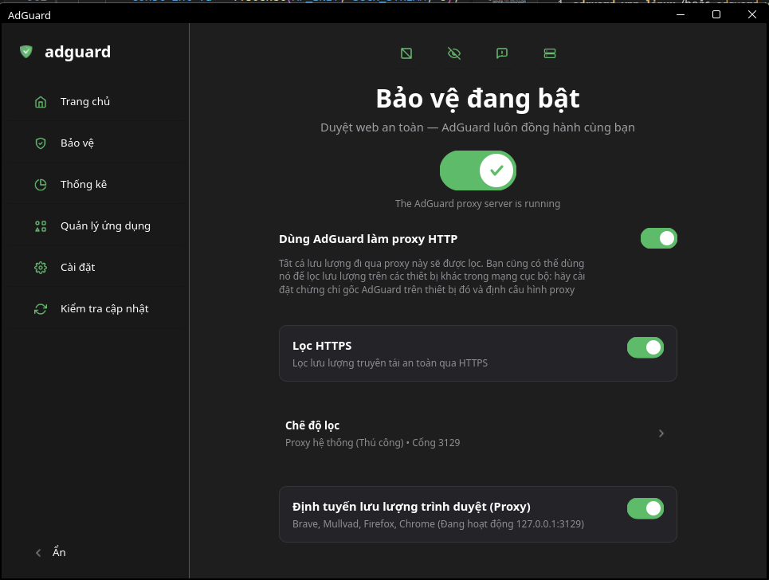

# AdGuard UI for Linux

<p align="center">
  
</p>

<p align="center">
  <a href="#english">English</a> • <a href="#tiếng-việt">Tiếng Việt</a>
</p>

---

<a name="english"></a>
## 🇬🇧 English

An unofficial, high-performance native **GTK4** desktop frontend (wrapper) for the official **AdGuard CLI** (`adguard-cli`) on Linux. Re-architected in **Rust** to replace legacy Electron/Python frontends with native speed, low memory usage, and direct IPC communication.

> [!NOTE]
> This application is an independent open-source GUI frontend. It connects to and manages the official `adguard-cli` service daemon.

### ✨ Key Features
- **🌐 Bilingual UI:** Full native support for **English** and **Tiếng Việt** (switchable directly in General Settings).
- **🛡️ Comprehensive Protection Controls:** One-click toggle for ad blocking, tracking protection, and browsing security.
- **📊 Real-time Filtering Log:** Live stream of HTTP/HTTPS and DNS requests with filter rule matches, request details, and allow/block actions.
- **🔐 HTTPS Filtering:** Complete root CA certificate management (generate, inspect, export, and trust AdGuard Personal CA).
- **🌐 Advanced DNS Protection:** Full configuration for custom upstream DNS servers (DNS-over-HTTPS, DNS-over-TLS, DNSCrypt) and DNS blocklists.
- **🧩 Extensions & Userscripts:** Manage custom user scripts and browser extensions with automatic script discovery.
- **🎯 Per-Application Filtering:** Fine-grained control over which applications are filtered or bypassed from network inspection.
- **📥 System Tray:** Native system tray icon with quick pause/resume toggles and active status indicators.

### 🚀 Building & Running

#### Prerequisites
- **Rust & Cargo** (1.75+)
- **GTK4** development libraries (`gtk4`, `cairo`, `pango`)
- **SQLite3** library (`libsqlite3-dev` / `sqlite`)
- **adguard-cli** backend service installed on your system

#### Build from Source
```bash
# 1. Clone repository
git clone https://github.com/ashdalat/adguard-ui-linux.git
cd adguard-ui-linux

# 2. Build release binary
cargo build --release

# 3. Launch application
./target/release/adguard-blocker-rebuilt
```

#### Run Script
```bash
./run.sh
```

### 📦 Packaging & Installation
Automated setup scripts are located in the `packaging/` directory:
- `packaging/setup_adguard_gui.sh`: Automatically installs the compiled binary, desktop entry, and icons into standard system directories.
- `packaging/start_adguard_service.sh`: Helper utility to verify and enable the `adguard-cli` systemd service.
- `packaging/uninstall_adguard_gui.sh`: Cleanly removes the GUI and desktop entries.

---

<a name="tiếng-việt"></a>
## 🇻🇳 Tiếng Việt

Giao diện đồ họa (GUI) **GTK4** thuần **Rust** hiệu năng cao dành cho **AdGuard CLI** (`adguard-cli`) chính thức trên Linux. Dự án được thiết kế lại hoàn toàn bằng Rust thay thế các bản bọc Electron/Python cồng kềnh trước đây, mang lại tốc độ phản hồi tức thì, tiết kiệm RAM và giao tiếp IPC trực tiếp.

> [!NOTE]
> Ứng dụng này là phần mềm giao diện đồ họa mã nguồn mở độc lập, kết nối và điều khiển dịch vụ daemon `adguard-cli` chạy trên hệ thống của bạn.

### ✨ Tính Năng Nổi Bật
- **🌐 Hỗ trợ Song Ngữ:** Tích hợp sẵn giao diện hoàn chỉnh cho **Tiếng Việt** và **Tiếng Anh** (chuyển đổi ngôn ngữ trực tiếp trong Cài đặt Chung).
- **🛡️ Bảng Điều Khiển Bảo Vệ Tập Trung:** Bật/tắt bảo vệ chặn quảng cáo, bảo vệ quyền riêng tư (chống theo dõi) và an toàn duyệt web chỉ với 1 click.
- **📊 Nhật Ký Lọc Thời Gian Thực (Filtering Log):** Bảng hiển thị luồng truy vấn HTTP/HTTPS và DNS trực tiếp, hiển thị luật bộ lọc trùng khớp và chi tiết chặn/cho phép.
- **🔐 Lọc HTTPS Toàn Diện:** Quản lý chứng chỉ gốc AdGuard Root CA (tạo mới, kiểm tra, cài đặt và tin cậy chứng chỉ để lọc quảng cáo trong kết nối mã hóa SSL).
- **🌐 Bảo Vệ DNS Nâng Cao:** Tùy chỉnh máy chủ phân giải DNS upstream an toàn (DoH, DoT, DNSCrypt) cùng các bộ quy tắc lọc DNS tùy biến.
- **🧩 Quản Lý Userscript & Tiện Ích:** Cài đặt và quản lý các script duyệt web người dùng tùy chỉnh với khả năng tự động nhận diện script.
- **🎯 Lọc Theo Từng Ứng Dụng:** Chọn lọc chính xác ứng dụng nào đi qua bộ lọc AdGuard hoặc bỏ qua không lọc.
- **📥 Khay Hệ Thống (System Tray):** Chạy ngầm tiện lợi với menu tạm dừng/tiếp tục bảo vệ nhanh chóng.

### 🚀 Hướng Dẫn Biên Dịch & Cài Đặt

#### Yêu cầu môi trường
- **Rust & Cargo** (1.75 trở lên)
- **GTK4** thư viện phát triển (`gtk4`, `cairo`, `pango`)
- **SQLite3** thư viện (`libsqlite3-dev` hoặc `sqlite`)
- Đã cài đặt dịch vụ backend **adguard-cli**

#### Biên dịch từ mã nguồn
```bash
# 1. Tải repository
git clone https://github.com/ashdalat/adguard-ui-linux.git
cd adguard-ui-linux

# 2. Biên dịch bản tối ưu
cargo build --release

# 3. Khởi chạy
./target/release/adguard-blocker-rebuilt
```

#### Khởi chạy nhanh
```bash
./run.sh
```

### 📦 Cài Đặt Vào Hệ Thống (Desktop Entry & Icon)
Trong thư mục `packaging/` đã chuẩn bị sẵn các script tự động:
- `packaging/setup_adguard_gui.sh`: Tự động sao chép file thực thi, cài đặt icon và file `.desktop` vào menu ứng dụng hệ thống.
- `packaging/start_adguard_service.sh`: Kiểm tra và kích hoạt dịch vụ `adguard-cli` qua systemd.
- `packaging/uninstall_adguard_gui.sh`: Gỡ bỏ sạch sẽ ứng dụng khỏi hệ thống.

---

## 📄 License

GPL-3.0 or MIT. Not affiliated with AdGuard Software Ltd.
